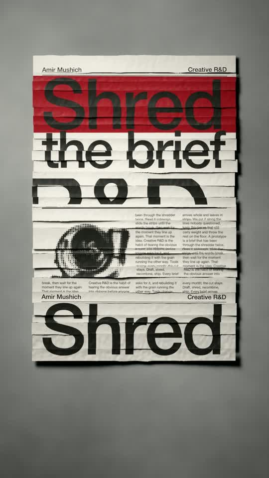
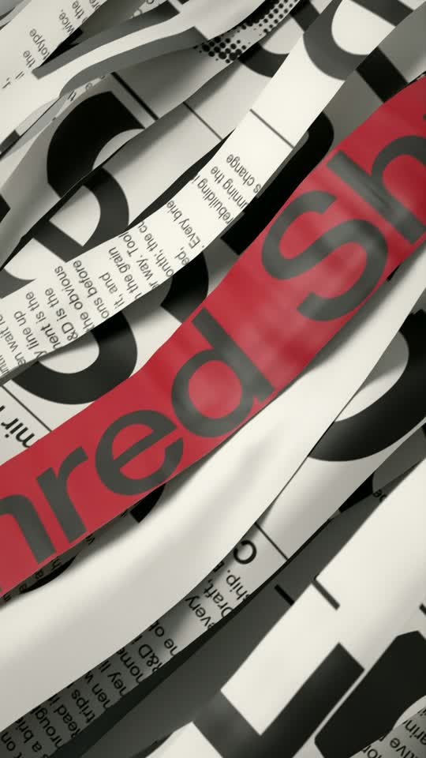
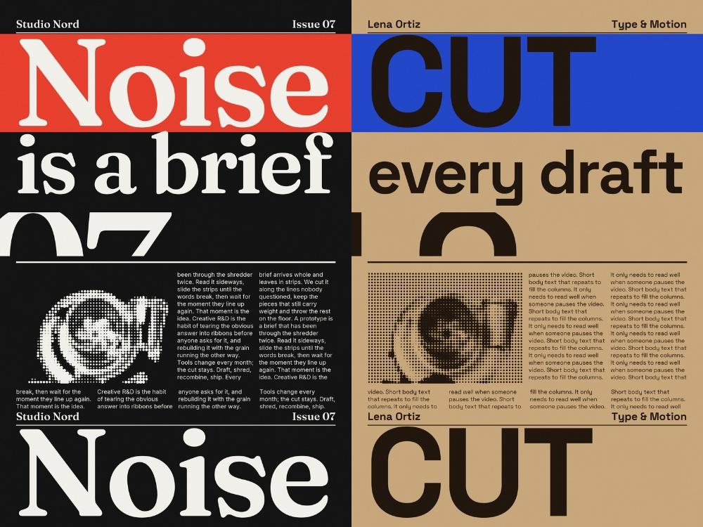
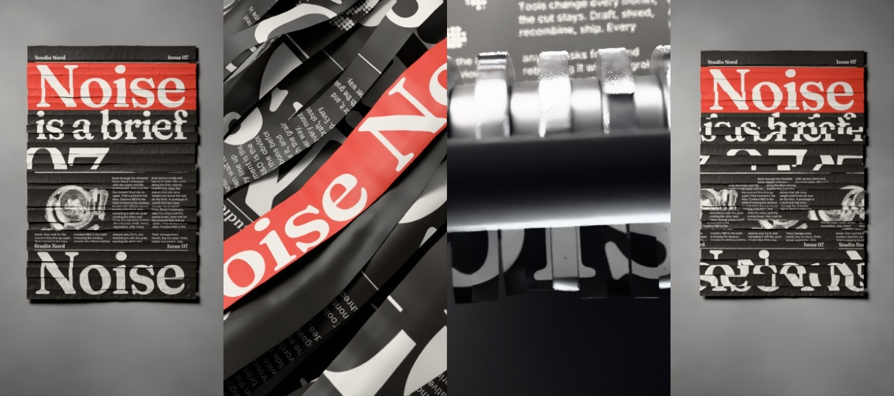
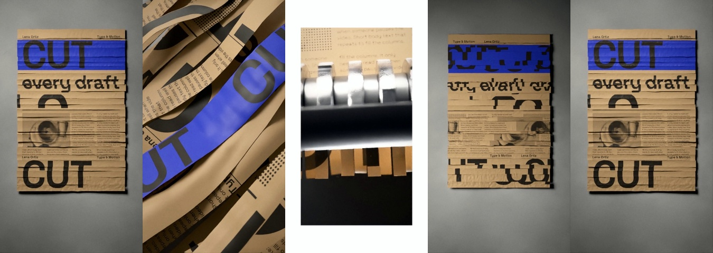

# Shred

**A video template you set up by talking to your AI agent.** Your words, fonts and colours on a printed poster.
The poster is ripped into strips, fed through a shredder and rebuilt line by line, with sound. You get an 8-second
vertical loop, 1080×1920 at 60 fps, rendered as real paper in Blender.

<p>
  <a href="docs/demo.mp4"></a>
  <a href="docs/demo.mp4"></a>
</p>

▶ [Watch the demo (with sound)](docs/demo.mp4)

## Make your own in one message

Open **Claude Code**, **Codex**, **Cursor** or any coding agent in an empty folder and say:

> Clone https://github.com/amirmushichge/shred-kit, read it and help me make my own version.

The repo includes a full playbook for the agent ([AGENTS.md](AGENTS.md)). The agent will:

1. **Check your machine.** It looks for Python, Blender, ffmpeg and a GPU, and offers to install what's missing.
2. **Brief you, one question at a time:**
   - your lines, with the recommended length for each;
   - fonts, with suggestions by mood (Swiss, tech, editorial, vintage, loud poster);
   - a colour palette, or your brand colours;
   - your picture;
   - sound on or off;
   - where you'll post it.
3. **Show a preview.** The poster appears in seconds, and four real 3D frames in about a minute.
4. **Estimate the render time on your machine,** then render and hand you the files.

## What you can change

| | |
|---|---|
| **Words** | 7 lines: two small lines, the headline, a subline, giant cropped letters, the footer, and body text |
| **Fonts** | any Google Fonts family by name, or your own .ttf/.otf |
| **Colours** | paper, ink and one accent band. Dark paper with light ink works too |
| **Picture** | any image, turned into a halftone that survives the shredder |
| **Sound** | a designed track (rip, falling paper, shredder, 25 clicks), mixed to −14 LUFS, or off |

The motion, camera, timing and edit are fixed and tuned together. That's what makes it a template.

Same template, other briefs (preview quality):







## You'll need

- **Blender 5.x** (tested with 5.2), free from blender.org.
- **Python 3.10+** and **ffmpeg**.
- **A GPU.** NVIDIA (OptiX/CUDA), AMD (HIP), Apple Silicon (Metal) or Intel (oneAPI) are picked automatically. CPU
  works, but slowly.
- **Render time.** A final render takes about 1 h 15 min on a laptop RTX 4070. A draft takes a quarter of that or less.
  `kit.py estimate` measures your machine before you commit.

## Without an agent

```bash
python -m venv .venv && .venv/bin/python -m pip install -r requirements.txt   # Windows: .venv\Scripts\python
python kit.py doctor                         # is everything installed?
python kit.py fields                         # what can I change?
python kit.py set text.headline "Ship"       # edit brief.json, one field at a time (or edit it by hand)
python kit.py poster                         # build/preview/poster.png, in seconds
python kit.py stills                         # four 3D frames, about a minute
python kit.py estimate --quality final       # how long will it take here?
python kit.py render --quality final --social
```

Outputs go to `out/`:
- the master MP4;
- social versions at 16 Mbit/s, 60 and 30 fps, plus two cover stills;
- the sound as a WAV;
- a frame-exact cue sheet, if you'd rather score it yourself.

## How it's made

Everything is code:
- `poster.py` draws the poster.
- `shred.py` builds and animates the scene in Blender:
  - strip geometry with a paper shader (ink, fibre, translucency, cut edges);
  - a ribbon cascade with height-map stacking, so paper never passes through paper;
  - a shredder with cutter discs, and one Hermite camera move;
  - true motion blur from averaged sub-frames.
- `edit.py` cuts the shots and finishes the frames: grade, glow, grain and punches.
- `sound.py` builds the sound from the render's own timings, so the sound follows any text you put in.

## License

- **Code:** GPL-3.0 (it drives Blender, which is GPL).
- **Sound recordings** in `assets/sound`: public domain (see [SOURCES.md](assets/sound/SOURCES.md)).
- **Demo picture:** the author's own render, free to use in videos made with this kit.
- **Your videos are yours,** to use however you like, commercially included.

Made by Amir Mushich.


## Local script-to-video workflow

本地版本新增“选择文案制作视频”入口：双击 `文案制作视频.app`，选择TXT或Markdown，自动生成中文配音、字幕与文字/步骤/对比/图片动画。详见 [中文使用说明](使用说明-文案制作视频.md)。

Local extension: choose a TXT/Markdown file to produce a narrated video with measured subtitles and text, steps, comparison or local-image scenes. Editable plans and deliverables are saved in `video_jobs/`. The original Blender template remains available. Build the macOS picker using `.venv/bin/python script_video/build_native_launcher.py`, or run `.venv/bin/python video.py make examples/文案示例.md`.
